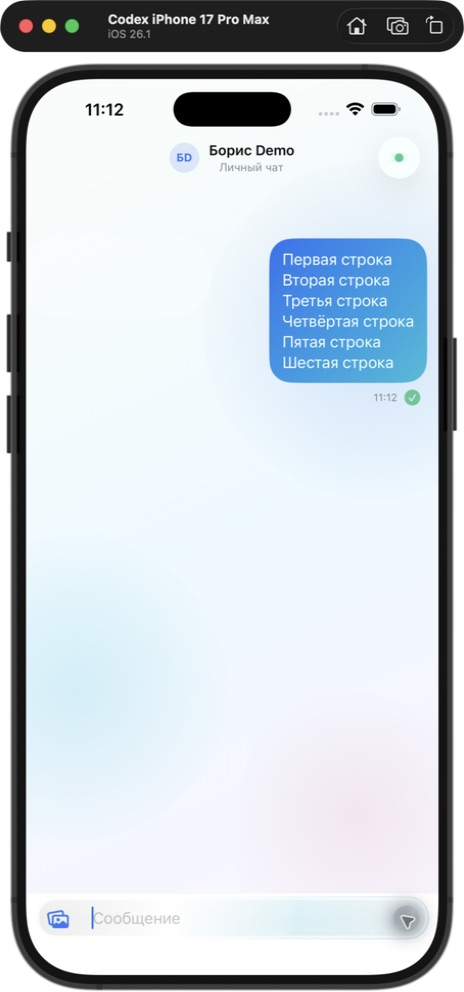
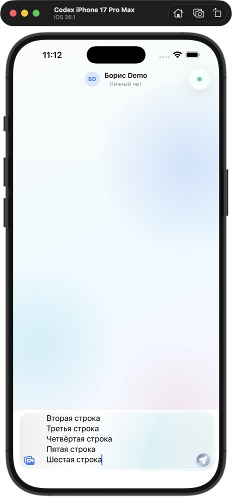

# Mobile Messenger

[](https://github.com/nepovtor/Mobile-Messenger-IOS/actions/workflows/swift.yml)

Messenger project with a native SwiftUI iOS app, a React web client, and a NestJS backend. Both clients use REST for account and chat operations and native WebSocket for realtime updates.

**Release status:** the repository contains working legacy messaging features and server-side preparation for encrypted delivery. Client E2EE is not implemented. The production configuration requires E2EE and rejects plaintext messaging; a public messaging release remains blocked by the [E2EE integration gates](docs/E2EE_ARCHITECTURE.md). The feature list below describes the implementation, not a claim that every feature is enabled on a deployed server.

## Components

| Component | Location | Stack |
| --- | --- | --- |
| Native app | [MobileMessengerIOS/](MobileMessengerIOS/) | SwiftUI, SwiftData, URLSession, Keychain; iOS 17+ |
| Web client | [web/](web/) | React 19, TypeScript, Vite, Zustand, Leaflet |
| Backend | [server/](server/) | NestJS 11, TypeORM, PostgreSQL, native WebSocket |
| Shared REST contract | [contracts/openapi.json](contracts/openapi.json) | Generated Swift and TypeScript route helpers |
| Documentation | [docs/README.md](docs/README.md) | Authentication, deployment, security, screenshots |

## Implemented features

### iOS

- Phone verification through the configured backend provider, including Telegram linking.
- Direct and group chats, paginated history, text and image messages, voice recording/playback.
- Editing and deleting own text messages; chat deletion.
- WebSocket delivery, typing and read events, reconnect, local pending-send retry.
- SwiftData cache, contacts by phone, profile display name editing.
- Map with opt-in location updates; contact locations require an existing explicit permission.
- Device-only Keychain session storage and cleanup on logout or account switch.
- APNs registration from the profile screen when the notification capability and provider are configured.

### Web

- Phone verification, Telegram linking, chat list and direct/group chat threads.
- Text and voice messaging, image display, message actions, native WebSocket updates.
- Contacts, profile editing, Leaflet/OpenStreetMap locations with share/stop controls; contact acceptance and per-contact grant management still require backend APIs.
- Web Push subscriptions through a service worker, plus in-app notifications.
- Landing page, messenger workspace, and protected administration/system pages.

See the [web client guide](web/README.md) for routes, environment variables, and browser requirements.

### Backend

- REST API, authenticated WebSocket gateway, heartbeat and connection cleanup.
- Revocable device sessions, short-lived access tokens, rotating refresh tokens, OTP rate limits.
- Telegram verification and configurable SMS providers.
- Contacts, per-contact location permissions, chat membership and message history.
- S3-compatible media storage, image validation, and legacy voice upload/playback.
- Web Push/VAPID and APNs providers with generic notification payloads.
- Device/prekey/envelope and encrypted attachment APIs that prepare the server for a future reviewed E2EE client.
- TypeORM migrations, administrator management CLI, protected system endpoints, redacted request/error logging.

## Architecture

```text
iOS: App -> Presentation -> Domain <- Data
Web: app -> features -> shared infrastructure
                 |
          REST / native WebSocket
                 |
  NestJS feature modules + ChatEventsModule
                 |
       PostgreSQL + S3-compatible storage
                 |
         Web Push / APNs providers
```

The iOS `App` layer owns composition, configuration, sessions, and platform services. `Domain` defines models and use cases; `Data` provides REST/WebSocket transport, persistence, and repositories. Backend chat events are separated from the realtime transport.

REST paths are maintained in [contracts/openapi.json](contracts/openapi.json). Regenerate helpers after a contract change; do not edit generated route files directly:

```bash
node Scripts/generate-api-contract.mjs
make contract-check
```

## Requirements

- Node.js 24 for a common backend/web development environment. The backend declares Node >=20.19; locked web dependencies require Node >=22, and ESLint 10 requires Node 22.13+ on the Node 22 line.
- PostgreSQL 16 for local development, or a configured PostgreSQL connection.
- Docker Compose for the optional local database/container setup.
- macOS and Xcode with an iOS 17+ SDK/simulator for the native app. The repository has been verified with Xcode 26.3.
- S3-compatible storage for media; real provider credentials for Telegram/SMS or push delivery.

## Local development

Run commands from the repository root unless a step changes directory. Use separate terminals for backend and web.

### 1. Backend

```bash
cp server/.env.example server/.env
```

Edit `server/.env`: set a local database password and generate independent secrets for the JWT keys, OTP pepper, refresh-token pepper, and log hash key. The example is for local development and disables demo accounts/test codes. Select a verification provider before testing login; see [SMS setup](docs/REAL_SMS_AUTH.md) or [Telegram setup](docs/TELEGRAM_AUTH.md).

Start only PostgreSQL when running Node on the host:

```bash
docker compose --env-file server/.env -f server/docker-compose.dev.yml up -d postgres
cd server
npm ci
```

Set `DB_SYNCHRONIZE=false` in `server/.env` to use migrations, then:

```bash
npm run migration:run
npm run start:dev
```

The development example defaults to `DB_SYNCHRONIZE=true`, which is a local schema shortcut. Use migrations for shared databases and production.

Local API: `http://127.0.0.1:8080/api`; WebSocket: `ws://127.0.0.1:8080/realtime`.

To run the backend and database together using the local schema-synchronization shortcut instead:

```bash
DB_SYNCHRONIZE=true \
  docker compose --env-file server/.env -f server/docker-compose.dev.yml up --build
```

This container shortcut initializes the local schema with synchronization. Development Compose does not run migrations automatically; use the host/migration flow above when `DB_SYNCHRONIZE=false`.

The development Compose file does not provision media storage. Configure S3 separately when testing attachments. Optional pgAdmin is in the `database-tools` profile.

### 2. Web

```bash
cd web
npm ci
VITE_DEV_PROXY_TARGET=http://127.0.0.1:8080 npm run dev
```

Open `http://127.0.0.1:3000`. The explicit proxy target keeps this flow on the local backend. Without an override, Vite forwards API/WebSocket traffic to the Cloudways host configured in [web/vite.config.ts](web/vite.config.ts).

See [web/README.md](web/README.md) for build-time API overrides, cookies, microphone/location permissions, and static hosting.

### 3. iOS

Open [MobileMessengerIOS.xcodeproj](MobileMessengerIOS.xcodeproj/) and choose the `MobileMessengerIOS` scheme. The shared scheme launches with **Release** configuration; tests use Debug. Both checked-in configurations target Cloudways.

For a Debug endpoint override, create the ignored `MobileMessengerIOS/Configurations/Debug.public.xcconfig` and select Debug in the scheme's Run action. The configuration keys are shown in [Debug.xcconfig](MobileMessengerIOS/Configurations/Debug.xcconfig). `Config/Config.example.xcconfig` is a reference template and is not automatically loaded by the project.

Build for a simulator without signing:

```bash
xcodebuild \
  -project MobileMessengerIOS.xcodeproj \
  -scheme MobileMessengerIOS \
  -configuration Debug \
  -destination 'generic/platform=iOS Simulator' \
  CODE_SIGNING_ALLOWED=NO build
```

For device signing, APNs, and distribution, follow the [App Store release checklist](AppStoreReleaseChecklist.md).

## Authentication and administration

Account registration uses `POST /api/auth/request` and `POST /api/auth/verify`; Telegram linking starts at `POST /api/auth/telegram/pairing`. Native sessions use authorization headers and Keychain. Browser sessions use HttpOnly cookies; production requires Secure cookies and explicit CORS/WebSocket origins.

Production disables demo/test authentication and requires the current/previous JWT key configuration in [server/production.env.example](server/production.env.example). Legacy `JWT_SECRET` examples are not a production configuration.

Administrators are created through the CLI after migrations:

```bash
cd server
npm run admin:create -- --login <login> --generate-password
```

Use a restricted terminal for this command. No administrator password is seeded from environment variables.

## Media and push configuration

| Feature | Backend configuration |
| --- | --- |
| Media | `S3_ENDPOINT`, `S3_BUCKET`, `S3_ACCESS_KEY`, `S3_SECRET_KEY`, `S3_REGION`; optional `S3_PUBLIC_ENDPOINT` for a separate client-facing host |
| Web Push | `WEB_PUSH_VAPID_PUBLIC_KEY`, `WEB_PUSH_VAPID_PRIVATE_KEY`, `WEB_PUSH_VAPID_SUBJECT` |
| APNs | `APNS_TEAM_ID`, `APNS_KEY_ID`, `APNS_BUNDLE_ID`, `APNS_PRIVATE_KEY`, `APNS_ENVIRONMENT` |

Images use presigned uploads and confirmation; voice uses the legacy authenticated `/api/media/voice` endpoint. Both depend on configured storage and the backend plaintext policy. Missing VAPID/APNs credentials cause the relevant provider to skip delivery with a warning.

The iOS project includes entitlements with `aps-environment`: development for Debug and production for Release. Notification registration still requires a matching provisioning profile and Apple capability setup.

## Security and release limits

Client E2EE, cross-platform protocol interoperability, and identity verification remain unfinished. The server's opaque delivery tables and endpoints do not provide end-to-end encryption by themselves. The [October 1 reassessment](docs/E2EE_REASSESSMENT_2026-10-01.md) records the latest checked-in review; older library decisions are historical records.

Keep `E2EE_REQUIRED=true` in production. Current legacy clients cannot send production messages through this boundary; plaintext media and location operations are also restricted. Do not disable this gate to describe the project as release-ready.

Location sharing is off by default, stores only the latest point, and requires accepted contact status plus a separate revocable permission for contact visibility. Native permission-grant management is not yet complete.

Push payloads are generic. Application logging records request IDs, methods, route templates, status codes, duration, and internal identifiers; raw auth values, message bodies, coordinates, and presigned URLs are excluded.

See the [documentation index](docs/README.md) for the threat model, audit, key-management plan, deployment controls, and incident/backup procedures.

## Deployment

The checked-in client configurations use `https://phpstack-1634854-6489525.cloudwaysapps.com` with REST under `/api` and WebSocket at `/realtime`. This is a configured endpoint, not a verification of its live availability or deployed version.

- [Production security/deployment guide](docs/SECURITY_DEPLOYMENT.md)
- [Cloudways PM2 fallback runbook](docs/cloudways-pm2-run.md)
- [Cloudways Telegram configuration](docs/telegram-auth-cloudways.md)
- [Backend production environment template](server/production.env.example)
- [Production Compose](server/docker-compose.yml), [root Dockerfile](Dockerfile), [backend Dockerfile](server/Dockerfile)
- [Legacy Railway configuration](railway.toml)

Production Compose uses external PostgreSQL/S3, runs migrations before startup, and exposes the backend only on loopback for a reverse proxy:

```bash
PRODUCTION_ENV_FILE=/secure/config/mobile-messenger.production.env \
  docker compose -f server/docker-compose.yml up --detach --build
```

Provision and validate the protected environment and complete the documented release gates before deploying. A GitHub documentation update does not deploy the application.

## Verification

From the repository root:

```bash
make contract-check
Scripts/verify-production-security.sh
git diff --check
```

Backend (from `server/`, after `npm ci`):

```bash
npm run format:check
npm run lint
npm test
npm run build
```

Web (from `web/`, after `npm ci`):

```bash
npm run format:check
npm run lint
npm test
npm run build
```

For iOS tests, list installed simulators with `xcrun simctl list devices available`, then use an available device ID:

```bash
xcodebuild \
  -project MobileMessengerIOS.xcodeproj \
  -scheme MobileMessengerIOS \
  -destination 'platform=iOS Simulator,id=<SIMULATOR_UDID>' \
  CODE_SIGNING_ALLOWED=NO test
```

[GitHub Actions](.github/workflows/swift.yml) defines iOS tests/Release builds, backend and web formatting/lint/tests/builds, contract checks, dependency audits/signature checks, PostgreSQL migration smoke tests, secret scanning, and container scanning. CodeQL and dependency review jobs run only when their repository variables are enabled. The status badge links to actual results.

## Screenshots

These are the existing iOS simulator captures; they document earlier UI work and are not a complete current release screenshot set.

| Chat message | Multiline composer |
| --- | --- |
|  |  |

See the [screenshot inventory](docs/screenshots/README.md) for the comparison capture and remaining portfolio views.

## Repository hygiene

Keep credentials, local environment files, dependency folders, build output, Xcode user state, databases, logs, and deployment archives out of Git. The tracked environment examples contain placeholders only.
